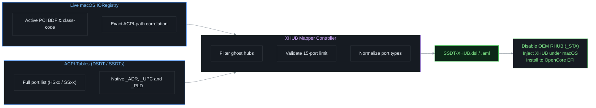

# XHUB Mapper

> **A beginner-friendly tool to map your Hackintosh USB ports cleanly via ACPI—no extra kexts required!**

---

## 📖 About

### What is USB Port Mapping?
macOS has a built-in limit of **15 USB ports per controller**. While your PC might only have 6 or 8 physical USB sockets on the outside, a modern motherboard actually has far more logical ports under the hood. A single USB 3.0 port counts as **two ports** (one for USB 2.0 speed, and one for SuperSpeed 3.0 speed). Internal headers for Bluetooth, webcams, and front panels count as well.

If your motherboard exceeds 15 ports and you don't configure which ones to keep, macOS will randomly drop ports, cause sleep/wake crashes, or disable your Bluetooth card.

### What is the XHUB Method?
Most guides recommend injecting custom `.kext` files (like `USBMap.kext` or `USBToolBox.kext`). While these work, they can break during major macOS updates.

The **XHUB Method** (developed by samuelnotfound) maps your ports directly into your motherboard's firmware tables (**ACPI**):
- **100% Kext-less:** Works purely through a tiny SSDT file (`SSDT-XHUB.aml`).
- **Update-Proof:** Survives macOS updates, major version upgrades, and OS reinstalls.
- **Dual-Boot Safe:** It disables the stock USB hub **only when macOS boots**. Windows and Linux continue using all ports normally.

### What does this tool do?
`xhub_mapper.py` takes all the tedious manual coding out of the XHUB method:
1. **Detects Real Hardware:** Queries macOS in real time to identify which USB controllers are actually plugged in and active, ignoring phantom/ghost controllers.
2. **Accepts Multiple Formats:** Works with your dumped ACPI tables (DSDT/SSDT) or pre-made dumps from popular tools like **USBToolBox** (`usb.json`) and **USBMap** (`USB.plist` / `USB.json`).
3. **One-Click Installation:** Builds the SSDT, compiles it, places it into your `EFI/OC/ACPI` folder, and automatically enables it in your OpenCore `config.plist`.

### How It Works



---

## 📋 Prerequisites

Before using the tool, ensure you have:
1. A Mac or running Hackintosh (macOS 10.15 Catalina or newer).
2. [Python 3](https://www.python.org/) installed (Version 3.12 or later is required). 
3. Files:

    - Mandatory: Your PC's ACPI tables (e.g. from an OpenCore `SysReport` folder or dumped using SSDTTime).
    - Optional: A discovery file exported from [USBToolBox](https://github.com/USBToolBox/tool?utm_source=chatgpt.com) (`usb.json`) or [USBMap](https://github.com/corpnewt/USBMap?utm_source=chatgpt.com) (`USB.plist`). Use the respective JSON export features where available.

&#x20;  These optional files are useful if you want to migrate from kext-based to ACPI-based USB port mapping. They allow you to reuse your existing port mapping instead of having to map all ports from scratch.

---

## 🚀 Beginner's Guide: Step-by-Step

### Step 1: Download & Open the Tool
1. Click the green **Code** button at the top of this repository and select **Download ZIP** (or clone the repository with Git).
2. Unzip the downloaded folder.
3. Open the **Terminal** app on your Mac (press `Cmd + Space`, type `Terminal`, and hit Enter).
4. Enter the following command to start teh script:

   ```bash
   Python3 ~/Downloads/XHUB-Mapper-main/xhub_mapper.py
   ```
> [!NOTE]
>
> Alterntaively, you can enter `python3` press space bar and then drag and drop `xhub_mapper.py` into the Terminal and then press enter.

---

### Step 2: Load Your Ports
You have two easy ways to feed your ports into the tool:

#### Option A: Using your ACPI tables (Recommended for a clean start)
1. In the main menu, type `1` and hit **Enter**.
2. **Drag and drop** your ACPI folder (e.g. `SysReport/ACPI`) or your `DSDT.aml` / `.dsl` files directly into the Terminal window and hit **Enter**.
3. If prompted to download `iasl` (the compiler), type `y` and press **Enter**.
4. The tool will read your tables and cross-reference them with your live hardware to highlight your active controllers.

#### Option B: Importing an existing dump from USBToolBox or USBMap
1. In the main menu, type `1` and hit **Enter**.
2. **Drag and drop** your ACPI folder (e.g. `SysReport/ACPI`) or your `DSDT.aml` / `.dsl` files directly into the Terminal window and hit **Enter**.
3. If prompted to download `iasl` (the compiler), type `y` and press **Enter**.
4. Return to the main menu.
5. In the main menu, type `5` and hit **Enter**.
6. **Drag and drop** your `usb.json` or `USB.plist` file into the Terminal window and hit **Enter**.

---

### Step 3: Choose Which Ports to Keep
1. In the main menu, type `2` and hit **Enter**.
2. If you have more than one controller, type the number of the controller you want to edit.
3. You will see a list of all ports (e.g., `HS01`–`HS14` for USB 2.0, `SS01`–`SS10` for SuperSpeed 3.0):

```text
  #   Port   _ADR   Use    Type            OEM    Label
  1   HS01   0x01   [x]    typea           on     Front Left USB2
  2   HS02   0x02   [x]    typea           on     Front Right USB2
  ...
 15   SS01   0x11   [x]    usb3-a          on     Front Left USB3
```

#### How to edit:
- **Toggle a port on or off:** Type `k <number>` (e.g. `k 1` or `k 1,2,5-8`) and press **Enter**.
- **Change a port's connector type:** Type `t <number> <type>` (e.g., `t 15 usb3-a`).
- **Label a port (so you remember what it is):** Type `l <number> <description>` (e.g., `l 1 Front USB Left`).
- **Finish editing:** Type `d` and press **Enter** to go back.

> [!IMPORTANT]
> **The 15-Port Rule:**
> You can select a maximum of **15 ports** (`[x]`) per controller. If your count exceeds 15, uncheck ports you don't use until you are at or below 15.

> [!CAUTION]
> **Bluetooth & Webcams Must Be "Internal":**
> If a port powers your motherboard's internal Bluetooth card or a laptop webcam, you **must** set its type to `internal`:
> ```text
> t 7 internal
> ```
> *(Replace `7` with the port number your Bluetooth is plugged into).* If this is not set to `internal`, Bluetooth will disconnect randomly or fail to wake from sleep!

---

### Step 4: Generate and Install to OpenCore
1. In the main menu, type `3` (**Generate SSDT-XHUB**) and press **Enter**.
2. The tool will check your configuration and compile your `SSDT-XHUB.aml`.
3. When prompted:
   ```text
   Drag EFI/OC folder here to install (or enter to skip):
   ```
   **Drag and drop your USB flash drive's or system's `EFI/OC` folder** directly into the Terminal window and hit **Enter**.
4. The tool will automatically:
   - Copy `SSDT-XHUB.aml` into your `EFI/OC/ACPI/` folder.
   - Back up your `config.plist`.
   - Add and enable `SSDT-XHUB.aml` in `config.plist -> ACPI -> Add`.
   - Add any necessary controller rename patches (e.g. `XHC1 -> SHCI`) in `config.plist -> ACPI -> Patch`.

---

### Step 5: Reboot and Verify
1. Restart your computer.
2. In macOS, plug a USB 2.0 and a USB 3.0 device into each port to ensure everything connects properly.
3. Open **System Settings > Bluetooth** to verify Bluetooth connects and wakes normally.

---

## 🔌 ACPI Connector Types (`_UPC`)

When setting a port's type using the `t` command, use these type names:

| Type Name | Byte Value | Description |
| :--- | :---: | :--- |
| `typea` | `0x00` | Standard USB 2.0 Type-A connector |
| `usb3-a` | `0x03` | Standard USB 3.0 Type-A connector (SuperSpeed companion) |
| `internal` | `0xFF` |  **Mandatory for internal devices:** Bluetooth modules, laptop webcams, LED/AIO pump controllers. |
| `typec-hs`| `0x08` | Type-C connector operating strictly in USB 2.0 mode |
| `typec-switch` | `0x09` | Type-C with internal hardware switch (same personality on flip) |
| `typec-noswitch` | `0x0A` | Type-C without hardware switch (two distinct personalities on flip) |

---

## 🛠️ Troubleshooting

### 1. Ports or `_ADR` show a `?`
- **Why it happens:** Some motherboards don't write port addresses as plain numbers; they compute them at boot time with code methods, or define the ports in secondary SSDT tables instead of the main DSDT.
- **How to fix:**
  1. Make sure you load your **entire ACPI folder** (e.g. `SysReport/ACPI`), not just `DSDT.aml`. Many Intel boards define the controller in DSDT but define the actual ports in tables named `SSDT-xh_...aml`.
  2. In the port editor, run the automatic address guessing command:
     ```text
     a auto
     ```
     This automatically fills in the missing addresses following standard Intel layout conventions (`HS01 = 0x01`, `SS01 = 0x11`, etc.).
  3. You can also assign the address manually if you know it from IORegistry:
     ```text
     a 1 0x01
     ```

---

### 2. Conflicting USB Kexts (Ports Still Unmapped After Reboot)
- **Why it happens:** If you previously used kext-based USB mapping, those kexts will override your new SSDT.
- **How to fix:**
  1. Open your `config.plist` in an editor (like ProperTree or OpenCore Auxiliary Tools).
  2. Under `Kernel -> Add`, **disable or remove** old mapping kexts:
     - `USBPorts.kext`
     - `USBMap.kext`
     - `UTBMap.kext` and `USBToolBox.kext`
     - `USBInjectAll.kext`
  3. Under `Kernel -> Quirks`, ensure `XhciPortLimit` is set to `False` (this quirk is broken on macOS 11.3+ anyway).
  4. Save and reboot.

---

### 3. Bluetooth or Webcam Disconnects During Sleep
- **Why it happens:** macOS expects built-in devices to stay powered during sleep states. If the port is marked as external (`typea`), macOS cuts power to it when entering sleep.
- **How to fix:** 
  In the port editor, identify which port powers your Bluetooth module or webcam (look for the `<- OEM Bluetooth port (DBPN)` hint in the editor) and change its type to `internal`:
  ```text
  t <port_number> internal
  ```
  Then re-generate the SSDT (`Option 3`).

---

### 4. Controller Rename Not Applied (`XHC1` Collision)
- **Why it happens:** If your motherboard's USB controller is named `XHC1`, macOS's built-in Apple USB drivers might attach their own default port map and ignore your SSDT.
- **How to fix:**
  When installing through the tool, `xhub_mapper` creates an ACPI patch (`XHC1` to `SHCI`).
  - Open `config.plist` and look under `ACPI -> Patch`.
  - Ensure the patch `XHC1 to SHCI` has `Enabled = True`.

---

### 5. "Selected: X/15 !! OVER LIMIT !!" Warning
- **Why it happens:** macOS enforces a strict limit of 15 ports per controller. If you keep 16 or more, macOS will discard the extra ports or fail to boot cleanly.
- **How to fix:**
  In the port editor, use `k <number>` to turn off ports you do not need (for example, internal headers you don't plug cables into, or USB 2.0 personalities on ports where you only care about USB 3.0 speeds).

---

### 6. Error: "No RHUB/HUBN device found in the loaded tables"
- **Why it happens:** The tables you dropped into the tool do not contain a recognized root hub.
- **How to fix:**
  - Make sure your system's **DSDT** is included in the folder you provided.
  - If you dropped single files, select your whole `ACPI` dump folder instead.

---

## ❓ Frequently Asked Questions (FAQ)

#### What should I do if ports display a "?" instead of a valid name or address?
If a port shows `?` under the `_ADR` or `Port` column:
1. Make sure you drag the **entire ACPI folder** (including all SSDTs) into the tool.
2. In the port editor, type `a auto` and press **Enter** to let the tool calculate standard addresses automatically.
3. You can also assign the address manually using `a <port_number> <address>` (e.g. `a 1 0x01`).

#### How do I drag and drop a folder into Terminal?
Click and hold the folder in Finder, drag your cursor into the Terminal window, and release. macOS will automatically type out the complete path for you.

#### What if I have multiple controllers listed?
Modern desktop PCs often have one main chipset controller (usually named `XHC` or `XHC1`) and secondary add-in controllers (like ASMedia or Thunderbolt). The tool marks the main controller as **`[ACTIVE]`**. You typically only need to map the controller that controls your case and motherboard I/O ports.

#### Can I undo changes to my OpenCore config?
Yes! Every time the tool installs an SSDT to your `EFI/OC`, it creates a timestamped backup of your config (e.g., `config.plist.bak-20261029-234100`) right next to your original file.

---

## 👏 Credits & Acknowledgments

- **[samuelnotfound](https://github.com/samuelnotfound)** for the [XHUB Method](https://github.com/samuelnotfound/miscellaneous-hackintosh-guides).
- **[corpnewt](https://github.com/corpnewt)** for SSDTTime decompilation logic and USBMap.
- **[DhinakG](https://github.com/DhinakG)** for the USBToolBox framework.
- **[Acidanthera](https://github.com/acidanthera)** for OpenCorePkg and MaciASL tools.
