# XHUB-Mapper – Processing Workflow

## About
The XHUB-Mapper workflow has two main stages: discover and map USB controllers/ports, then generate and optionally compile/install `SSDT-XHUB.aml`.

The diagram below follows the actual processing logic in `xhub_mapper.py` v3.0.1, including live IORegistry detection, ACPI parsing, port-map imports, interactive selection, and SSDT generation.

## Main processing stages

| Stage            | Functionality                                      | Result                       |
| ---------------- | -------------------------------------------------- | ---------------------------- |
| 1. Input         | Load DSDT/SSDT or existing port map                | Source data                  |
| 2. Parsing       | Decompile AML, parse ASL and resolve ACPI paths    | ACPI structure               |
| 3. Discovery     | Find RHUB/HUBN devices and extract ports           | Controller inventory         |
| 4. Introspection | Query IORegistry and correlate PCI/ACPI paths      | Active vs. ghost controllers |
| 5. Port mapping  | Resolve `_ADR`, `_UPC`, `_PLD` and connector types | Port configuration           |
| 6. Selection     | Interactive editing or imported configuration      | Selected ports               |
| 7. Generation    | Validate and construct SSDT-XHUB DSL               | `SSDT-XHUB.dsl`              |
| 8. Compilation   | Compile with ACPICA `iasl`                         | `SSDT-XHUB.aml`              |
| 9. Installation  | Copy AML and update OpenCore configuration         | Installed SSDT               |

## Implementation details

- **Live controller detection**: The script uses `ioreg` to identify actual USB host controllers and distinguish them from dormant ACPI entries.
- **ACPI parsing**: It builds a syntax tree instead of relying exclusively on regular-expression matching. It also evaluates supported ASL expressions to resolve dynamically calculated `_ADR` values.
- U**SBMap integration**: Existing configurations can be matched against ACPI ports using controller paths and `_ADR` values. Original ACPI names and paths are preserved during matching.
- **Port validation**: Only selected ports are emitted by default. The macOS limit of 15 ports per controller is checked before generation.
- **OpenCore integration**: Installation includes an automatic `config.plist` backup and the necessary controller rename patches.

One important distinction: `ports.json` is an intermediate configuration format. The actual ACPI implementation is generated separately as `SSDT-XHUB.dsl`, which can then be compiled into AML.

## Workflow Diagram

```mermaid
flowchart TD
    A([Start]) --> B{Platform check}
    B -->|Not macOS| X([Exit])
    B -->|macOS| C{Execution mode}

    C -->|Interactive| D[Initialize TUI]
    C -->|Scan| E[Load ACPI tables]
    C -->|Generate| N[Load port configuration]
    C -->|Test| T[Run tests]

    D --> F[Select ACPI folder / tables]
    E --> F
    F --> G[Discover DSDT and SSDT files]
    G --> H{Input format}
    H -->|AML| I[Decompile with iasl]
    H -->|DSL| J[Read ASL source]
    I --> J

    J --> K[Parse ACPI tables]
    K --> L[Build syntax tree and resolve ACPI paths]
    L --> M[Find RHUB / HUBN root hubs]
    M --> O[Extract USB port devices]
    O --> P[Resolve _ADR, _UPC and _PLD]
    P --> Q[Inspect IORegistry using ioreg]
    Q --> R[Identify active XHCI controllers]
    R --> S[Match ACPI controllers with live hardware]
    S --> U[Identify active and ghost controllers]

    U --> V{Execution mode}
    V -->|Scan| W[Export ports.json]
    W --> W1([Scan complete])

    V -->|Interactive| Y[Display controller and port list]
    Y --> Z[Select controller]
    Z --> AA[Edit port configuration]
    AA --> AB[Enable / disable ports]
    AB --> AC[Set connector types and labels]
    AC --> AD{Next action}

    AD -->|Save| AE[Write ports.json]
    AE --> Y
    AD -->|Import| AF[Load existing port map]
    AF --> AG{Format}
    AG -->|USBMap plist| AH[Parse enabled ports and addresses]
    AG -->|USBToolBox JSON| AI[Normalize port data]
    AG -->|Native JSON| AJ[Load native configuration]
    AH --> AK[Match controller paths and _ADR]
    AI --> AK
    AJ --> AK
    AK --> AL[Import port settings]
    AL --> Y

    AD -->|Generate SSDT| N
    N --> AM[Normalize selected controller data]
    AM --> AN[Validate ports and _ADR]
    AN --> AO{Validation passed?}
    AO -->|No| AP[Report errors]
    AP --> AQ([Abort])
    AO -->|Yes| AR[Generate SSDT-XHUB DSL]
    AR --> AS[Create XHUB and port devices]
    AS --> AT[Generate _STA, _UPC and _PLD]
    AT --> AU[Apply Darwin checks and rename patches]
    AU --> AV[Write SSDT-XHUB.dsl]

    AV --> AW{Compile with iasl?}
    AW -->|No| AX([DSL output])
    AW -->|Yes| AY[Compile DSL]
    AY --> AZ{Compilation successful?}
    AZ -->|No| BA[Report compiler errors]
    BA --> BB([Compilation failed])
    AZ -->|Yes| BC[Create SSDT-XHUB.aml]

    BC --> BD{Install to OpenCore?}
    BD -->|No| BE([AML output])
    BD -->|Yes| BF[Validate EFI directory]
    BF --> BG[Back up config.plist]
    BG --> BH[Copy AML to OC/ACPI]
    BH --> BI[Update config.plist]
    BI --> BJ([Installation complete])

    T --> BK([Tests complete])

    classDef input fill:#dbeafe,stroke:#2563eb,color:#172554
    classDef process fill:#e0f2fe,stroke:#0284c7,color:#0c4a6e
    classDef decision fill:#fef3c7,stroke:#d97706,color:#78350f
    classDef output fill:#dcfce7,stroke:#16a34a,color:#14532d
    classDef error fill:#fee2e2,stroke:#dc2626,color:#7f1d1d

    class F,G,I,J,N,E input
    class K,L,M,O,P,Q,R,S,U,Y,Z,AA,AB,AC,AF,AH,AI,AJ,AK,AL,AM,AN,AR,AS,AT,AU,AV,AY,BC,BF,BG,BH,BI process
    class B,C,H,V,AD,AG,AO,AW,AZ,BD decision
    class W,W1,AX,BE,BJ,BK output
    class X,AP,AQ,BA,BB error
```

